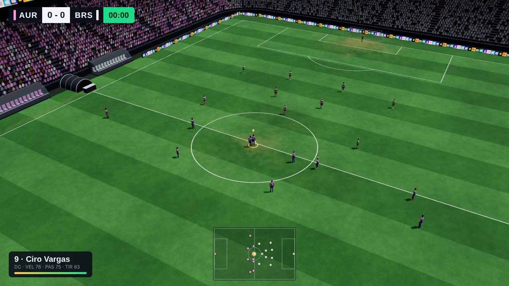
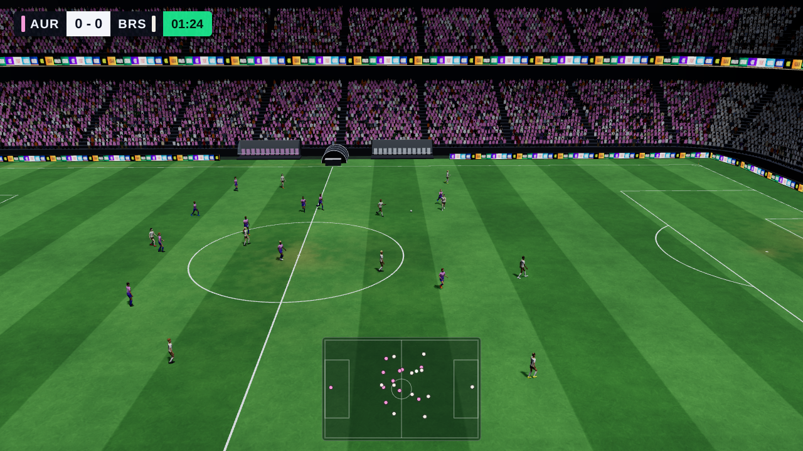
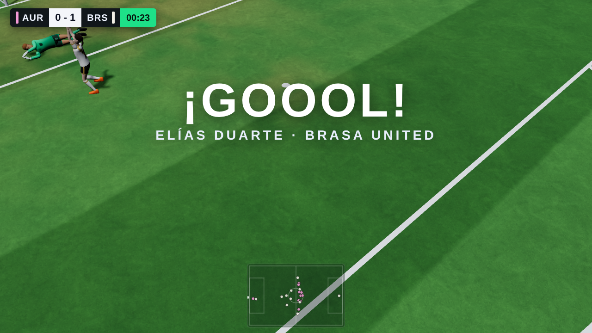
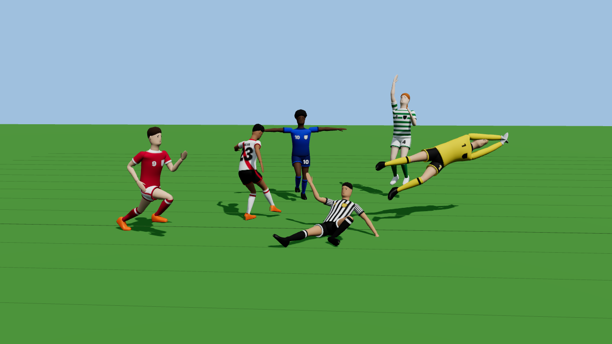
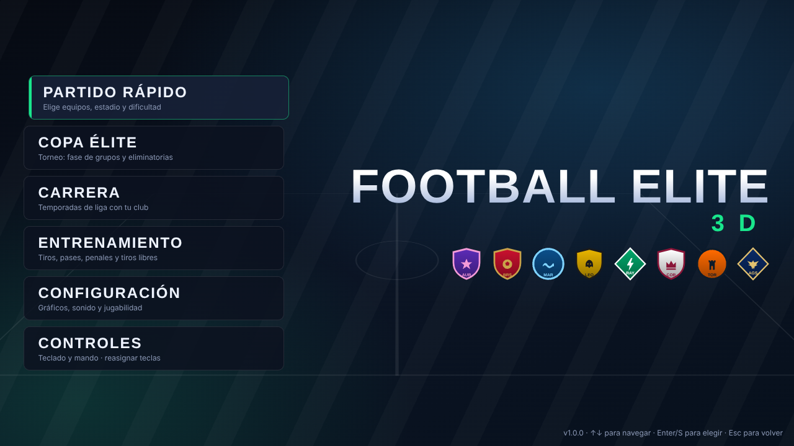

# ⚽ Football Elite 3D — v1.0.0

Juego de fútbol 3D completo, 11 contra 11 con arquero, con física de balón propia, inteligencia artificial táctica, reglas y arbitraje, cuatro modos de juego y controles con el esquema clásico de los juegos de fútbol de PC (FIFA) para teclado y mando.



| | |
|---|---|
|  |  |
|  |  |

---

## 1. Tecnología elegida y por qué

| Componente | Elección |
|---|---|
| Motor 3D | **Three.js 0.170** (WebGL 2) |
| Lenguaje | **TypeScript** (modo estricto) |
| Compilación | **Vite 5** |
| Ejecutable de escritorio | **Electron 33** (Linux y Windows x64) |
| Pruebas | **Vitest** (unitarias y simulación) + **Playwright** (extremo a extremo con el navegador real) |

Antes de programar se evaluaron Godot, Unity y Unreal. El entorno de desarrollo no tenía GPU ni ningún motor instalado, y la descarga de Godot estaba bloqueada; Unity y Unreal requieren cuentas, licencias y editores gráficos. Three.js + TypeScript permitió:

- **probar todo de forma autónoma**: la simulación se ejecuta sin gráficos (partidos completos IA contra IA en segundos) y el juego real se prueba en Chromium sin GPU;
- **física e IA propias** a medida del fútbol (más control que un motor genérico);
- un **ejecutable nativo** con Electron, sin licencias ni servicios de pago.

Todos los recursos (modelos, animaciones, estadio, público, texturas, escudos, música y sonidos) se **generan proceduralmente** en código. No se usa ningún recurso externo, marca, escudo o nombre protegido.

## 2. Ubicación

- **Proyecto fuente**: la raíz de este repositorio (`/home/user/football.game` en el entorno de desarrollo).
- **Compilación web**: `dist/` (se genera con `npm run build`).
- **Ejecutables**: `release/FootballElite3D-linux-x64/FootballElite3D` y `release/FootballElite3D-win32-x64/FootballElite3D.exe` (se generan con `npm run package`). No se suben al repositorio por su tamaño (unos 260 MB cada uno).

## 3. Cómo iniciar el juego

Requisito: **Node.js 18 o superior**.

```bash
npm install          # instalar dependencias (una sola vez)
npm run build        # compilar el juego en dist/
```

Luego elige una de estas opciones:

| Opción | Comando |
|---|---|
| **Aplicación de escritorio** (recomendada) | `npm run electron` |
| **Navegador** (Chrome, Edge o Firefox) | `npm start` (abre http://localhost:8080) |
| **Generar ejecutables** Linux + Windows | `npm run package` → carpeta `release/` |
| Modo desarrollo con recarga en caliente | `npm run dev` |

En Windows, tras `npm run package`, abre `release\FootballElite3D-win32-x64\FootballElite3D.exe`. En Linux, ejecuta `release/FootballElite3D-linux-x64/FootballElite3D`. **F11** alterna la pantalla completa en la aplicación de escritorio.

## 4. Controles (idénticos al esquema clásico de FIFA)

Mantén pulsado un botón de pase o tiro para **cargar la barra de potencia** y suéltalo para golpear. Si lo pulsas antes de que llegue el balón, el jugador lo golpea **de primera** (volea o cabezazo si el balón llega alto).

| Acción | Teclado (clásico) | Mando Xbox / PlayStation |
|---|---|---|
| Moverse | Flechas | Stick izquierdo / Cruceta |
| Sprint | **E** | RT / R2 |
| Pase corto · Cabezazo | **S** | A / ✕ |
| Tiro · Volea | **D** (mantener = potencia) | B / ○ |
| Pase elevado · **Centro** (desde la banda) | **A** | X / □ |
| Pase al hueco | **W** | Y / △ |
| Tiro colocado con rosca | **Shift + D** | RB + B / R1 + ○ |
| Cambiar de jugador | **Q** (con dirección: al compañero en esa dirección) | LB / L1 |
| Contener (jockey) | **Ctrl** o **C** | LT / L2 |
| Pausa | **Esc** o **P** | Start / Options |
| **En defensa**: presionar al portador | mantener **S** | mantener A / ✕ |
| **En defensa**: entrada | **D** | B / ○ |
| **En defensa**: barrida | **A** | X / □ |
| **En defensa**: salida del arquero | mantener **W** | mantener Y / △ |
| **En defensa**: presión de un compañero | mantener **Shift** | mantener RB / R1 |
| Arquero con el balón | **S** saque con la mano · **A / D** despeje · **W** saque alto | A · X / B · Y |
| Penal a favor | flechas para apuntar + mantener **D** | stick + B / ○ |
| Penal en contra | mantén ← / → al patear el rival (lado de la estirada) | stick |

- El tiro sin dirección apunta automáticamente al palo más alejado del arquero; **cargar demasiado la barra eleva el balón** (puede irse por encima del travesaño).
- También hay un esquema alternativo **WASD + IJKL** y **todas las teclas se pueden reasignar** en *Controles*.
- *Configuración* permite ajustar la sensibilidad y la zona muerta del stick, la velocidad de la barra de potencia, la asistencia de pase (asistida o manual) y el cambio automático de jugador.

## 5. Modos de juego

| Modo | Contenido |
|---|---|
| **Partido rápido** | Elección de equipos (8 clubes ficticios), estadio (3: día, atardecer y noche), duración de cada parte (2–10 min), dificultad (Amateur, Profesional, Clase mundial, Leyenda), bando controlado (local, visitante o espectador IA contra IA) y formación. |
| **Copa Élite** (torneo) | 8 equipos en dos grupos de 4 (todos contra todos) con clasificación, cuadro de semifinales cruzadas y final. Las eliminatorias se deciden con prórroga y penales. Los demás partidos se simulan automáticamente y el progreso se guarda. |
| **Carrera** | Liga de 8 clubes a doble vuelta (14 jornadas), tabla de posiciones, calendario, resultados, plantilla de 18 jugadores con edad y media, editor de alineación y formación. Al final de la temporada hay historial de campeones, evolución de los jugadores (los jóvenes mejoran y los veteranos declinan; los retirados son reemplazados por juveniles) y una nueva temporada. Se guarda automáticamente. |
| **Entrenamiento** | Práctica libre (pases, conducción y tiros contra el arquero), **penales** y **tiros libres con barrera** desde posiciones aleatorias. |

## 6. Funcionalidades implementadas

**Partido**
- 11 contra 11 con arquero, campo de 105 × 68 m, arcos de 7,32 × 2,44 m con red y todas las líneas reglamentarias.
- Reloj de 90 minutos escalado a la duración elegida, tiempo añadido calculado según goles, faltas y tarjetas, descanso con cambio de campo, final del partido y pantalla de resultado con estadísticas.

**Física del balón**
- Gravedad, arrastre aerodinámico, efecto Magnus (tiros con rosca y centros con efecto), botes con pérdida de energía, rodadura con fricción del césped y transferencia de efecto al botar.
- Colisiones con postes, travesaño y redes por subpasos (el balón no las atraviesa ni a máxima velocidad) y deflexiones en el cuerpo de los jugadores.
- El balón nunca se teletransporta: la conducción se hace con pequeños toques físicos y los pases se calculan resolviendo la física (solución analítica para pases rasos y búsqueda numérica para balones elevados y tiros).

**Futbolistas**
- Modelos humanos 3D con esqueleto de 21 huesos y malla con piel, generados por código.
- Variedad de tonos de piel, peinados, alturas y botas; equipaciones con 5 patrones (liso, degradado, rayas, aros y banda); nombre y dorsal en la espalda y número en el pantalón; arqueros con guantes y manga larga.
- Animaciones: caminar, trotar y esprintar sin deslizamiento de pies (IK), conducción, pase, centro, disparo, cabezazo con salto, entrada, barrida, caídas y levantarse, control, saque de banda, estiradas del arquero, blocaje, saques del arquero, celebraciones (4 variantes) y lamentos, con transiciones suaves.

**IA táctica**
- Formaciones 4-3-3, 4-4-2, 4-2-3-1 y 3-5-2 que se desplazan y comprimen según el balón y la fase (ataque, defensa o transición).
- Presión al portador con cobertura, marcas zonales y al hombre, apoyos que buscan líneas de pase libres, desmarques a la espalda respetando el fuera de juego, persecución del balón suelto por quien llega antes (modelo de intercepción) y separación para evitar aglomeraciones.
- Decisiones con balón (pase, pase al hueco, pase elevado, centro, tiro, conducción o despeje) puntuadas según riesgo de intercepción, quién gana la carrera al espacio, progreso, espacio libre y calidad del tiro.
- Arqueros: se colocan en la bisectriz, leen la trayectoria con un tiempo de reacción, se estiran, atajan o despejan, salen a los centros y en el mano a mano (achican) y distribuyen el balón con la mano o con el pie.
- La dificultad cambia el tiempo de reacción, el ruido de decisión, la precisión, la intensidad de presión, la altura de la línea defensiva y la reacción del arquero. **Nunca cambia los atributos físicos.**

**Reglas y arbitraje** (basados en posiciones y contactos reales, nunca aleatorios)
- Saque inicial, goles (el balón cruza por completo la línea), saque de banda, de esquina y de arco.
- Faltas: el pie llega antes al rival que al balón; la gravedad depende de si la entrada es por detrás, de la velocidad y de la distancia al balón.
- Tarjeta amarilla, segunda amarilla y roja (incluida la ocasión manifiesta de gol del último defensor); el expulsado sale del campo y, si es el arquero, lo sustituye un jugador de campo.
- Tiros libres con barrera a 9,15 m y penales.
- Fuera de juego evaluado en el momento exacto del pase (penúltimo defensor y balón; sin fuera de juego en saques de banda, de arco ni de esquina).
- Regla de la cesión al arquero, tiempo añadido, prórroga y tanda de penales (5 lanzamientos y muerte súbita).

**Presentación**
- Estadio de tres anillos con techo, más de 20.000 espectadores animados que reaccionan al juego, vallas LED con marcas ficticias, banquillos, túnel, videomarcadores y banderines.
- Césped con franjas de corte, desgaste y detalle; sombras dinámicas e iluminación de día, atardecer y noche.
- Cámaras de transmisión (tres estilos y zoom), barrido de presentación, plano de celebración, **repeticiones en cámara lenta** con planos cinematográficos (se omiten con S o D) y cámara de penales.
- HUD con marcador, reloj, tiempo añadido, radar, jugador controlado con su resistencia, barra de potencia, avisos (gol, falta, tarjeta, fuera de juego), ayudas en balón parado e indicadores del receptor y la dirección de pase.
- Audio procedural original: golpeos, botes, postes, red, silbato, ambiente de estadio, gritos de gol, "¡uy!", aplausos, abucheos, sonidos de interfaz y música de menú.
- Menús animados navegables con ratón, teclado y mando; pantalla de carga con consejos; pausa; configuración de gráficos (calidad baja/media/alta, sombras, escala de resolución, antialiasing, radar, ayudas, repeticiones), sonido y jugabilidad. Todo se guarda en el almacenamiento local.

## 7. Arquitectura

```
src/
  config/     constantes reglamentarias y configuración persistente
  data/       equipos ficticios, plantillas, formaciones y estadios
  sim/        lógica del partido (Match), física del balón (Ball), jugadores, equipos,
              reglas (Rules), reanudaciones (SetPieces) y golpeos (Kicks)   ← sin dependencias gráficas
  ai/         IA de equipo (TeamAI), de jugadores (PlayerAI), arqueros, predicción y dificultad
  control/    control humano (esquema FIFA)
  input/      teclado y mando con asignaciones configurables
  render/     escena del partido, cámaras, balón; player/ (modelo con piel y animaciones),
              stadium/ (estadio, césped, arcos, público y cielo)
  audio/      motor de audio procedural y puente con los eventos del partido
  ui/         menús, HUD, escudos y equipaciones en SVG
  modes/      torneo, carrera y competiciones
  save/       guardado y carga
  game/       bucle del partido (paso fijo a 60 Hz)
tests/        pruebas unitarias y de simulación (Vitest)
scripts/      pruebas extremo a extremo, servidor local y empaquetado
electron/     envoltorio de escritorio
```

La simulación es determinista con semilla y funciona sin gráficos, así que se pueden simular partidos enteros en pruebas automáticas.

## 8. Pruebas realizadas y resultados

| Prueba | Comando | Resultado |
|---|---|---|
| Comprobación de tipos (TypeScript estricto) | `npx tsc --noEmit` | ✅ sin errores |
| Unitarias y de simulación | `npm test` | ✅ **29/29** |
| Extremo a extremo en Chromium real | `npm run build && npm run test:e2e` | ✅ **14/14** |
| Ejecutable de Linux bajo Xvfb | — | ✅ sin errores (detalle abajo) |

**Unitarias y de simulación (29 pruebas)**
- **Física del balón**: gravedad, rebotes y reposo; los botes pierden energía; distancia de los pases rasos; el balón nunca se acelera solo; puntería de los tiros; curva con efecto; rebote en el poste sin atravesarlo; la red retiene el balón; la red lateral impide entrar desde fuera.
- **Partidos IA contra IA**: con varias semillas se completan sin bloqueos, sin coordenadas inválidas, con pases, tiros y posesión de ambos equipos; también se marcan goles y la eliminatoria pasa por la prórroga y los penales hasta tener ganador.
- **Reglas**: detección de goles, saque de banda y córner correctos, fuera de juego, falta y tarjeta por barrida trasera sin tocar el balón, y entrada limpia que no es falta.
- **Control humano**: saque inicial con S y cambio al receptor, movimiento y sprint, y carga de la barra de potencia y disparo con D.
- **Modos**: calendario de todos contra todos, puntos, torneo completo hasta el campeón (también si el usuario queda eliminado) y temporada de carrera de 14 jornadas con su progresión.

**Extremo a extremo (14 pruebas)**
- La pantalla de título carga y se navega por el menú.
- Partido rápido: saque con **S**, movimiento con flechas + **E** y tiro con **D** (barra de potencia).
- Pausa con **Esc**, estadísticas, reanudar y **reiniciar el partido sin reiniciar la aplicación**.
- Final del partido, pantalla de resultado y revancha.
- Torneo: jugar un partido y registrar la jornada.
- Carrera: plantilla y alineación.
- Entrenamiento de penales.
- Configuración y reasignación de teclas.
- **Ningún error de JavaScript** durante toda la sesión.

**Ejecutable de Linux**: se lanzó bajo Xvfb, se inició un partido desde el menú sin errores y no hizo ninguna conexión de red externa (se desactivaron las conexiones en segundo plano de Chromium y la descarga de diccionarios).

**Estadísticas medias de la IA** (partidos IA contra IA de 2 × 2 min, dificultad *Clase mundial*): unas 75–110 acciones de pase con un 55–75 % completadas, 3–4 tiros, 0,5–1 goles y algunas faltas, tarjetas y atajadas por partido.

## 9. Problemas pendientes y limitaciones reales

- **Rendimiento en GPU real no medido.** El entorno de desarrollo no tiene tarjeta gráfica y todo se probó con renderizado por software (SwiftShader), que da pocos FPS. Por diseño (unas 250 llamadas de dibujo, mallas de entre 1.600 y 5.000 vértices por jugador, público instanciado), una GPU integrada moderna debería mantener 60 FPS en calidad media, pero no está verificado. Si va lento, baja la calidad, desactiva las sombras o reduce la escala de resolución en *Configuración*.
- **Audio procedural** (sintetizado, sin grabaciones): se verificó por análisis de señal (sin silencios, sin saturación y con espectros correctos), pero no se escuchó.
- **Reglas no implementadas**: ley de la ventaja, mano, faltas del arquero en sus estiradas a los pies, saque de banda mal ejecutado y cambios durante el partido (la plantilla y la alineación se gestionan en el modo Carrera). En un tiro libre indirecto se acepta un gol directo.
- **Partidos no jugados por el usuario** en torneo y carrera: se resuelven con un modelo estadístico (Poisson según la media de cada equipo), no con la simulación completa.
- **Sin multijugador local** (dos humanos) ni regates especiales con el stick derecho.
- **Equipación del visitante**: se elige automáticamente para que contraste con la del local; no se puede seleccionar a mano.
- **Animaciones procedurales**: más simples que una captura de movimiento real; las caras son estilizadas.
- **IA**: tiende a jugar mucho por el centro del campo y a generar pocas ocasiones claras en dificultades bajas. Es funcional y táctica, pero mejorable.
- Los ejecutables de Windows se generaron pero **solo se probó el de Linux** (no había Windows disponible).
